# Tutorial: from a floorplan PNG to robots in simulation

In this tutorial you build a site from scratch in the
[RMF Site Editor](https://github.com/open-rmf/rmf_site) and run it in Gazebo
with two `tinyRobot`s, the API server and the web dashboard. You will:

1. load a floorplan image and give it a real-world scale,
2. draw walls and a floor,
3. draw a navigation graph (lanes) and name its waypoints,
4. mark two waypoints as chargers,
5. place two TinyRobots and make them robots RMF can drive,
6. package the site, write the tinyRobot fleet config, build and run it.

The input is the example floorplan shipped in this folder,
[`example_site.png`](example_site/maps/example_site/example_site.png). The
finished [`example_site`](example_site/) is the answer key: if you follow
the steps, your `my_site` ends up the same.

The tutorial uses **RMF Site Editor 0.0.3**, the current release on
crates.io. The editor image from this repository is built from that same
release. Every step below was performed in it, the screenshots come from
it, and the result was built and run.

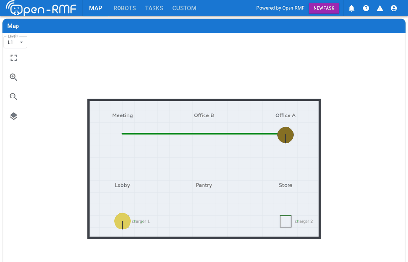

---

## What you need

- Docker with the Compose plugin.
- The RMF Site Editor 0.0.3, either installed from crates.io (option 1) or
  run from this repository's image with distrobox (option 2). Both are in
  [RMF Site Editor](../../README.md#rmf-site-editor) in the main README.
- This repository checked out on the `lyrical` branch. With option 2, put
  it somewhere under your home directory (a distrobox shares your home
  directory, not the rest of the disk).
- Internet access the first time you add the TinyRobot model (the editor
  downloads it once and caches it).
- About 30 minutes.

## The plan

The floorplan is a 20 m × 12 m room. At its scale of **50 pixels per metre**,
the image is 1100 × 700 px (22 m × 14 m including a 1 m margin). You will
place it so that the room's corners are at **(0, 0)** and **(20, 12)**, and
use these coordinates in metres:

| Waypoint | x | y | Tags |
|---|---|---|---|
| `lobby` | 3 | 3 | |
| `pantry` | 10 | 3 | |
| `store` | 17 | 3 | |
| `office_a` | 17 | 9 | |
| `office_b` | 10 | 9 | |
| `meeting` | 3 | 9 | |
| `tinyRobot1_charger` | 3 | 1.5 | Charger, Parking Spot, Holding Point |
| `tinyRobot2_charger` | 17 | 1.5 | Charger, Parking Spot, Holding Point |

The lanes are a loop `lobby → pantry → store → office_a → office_b →
meeting → lobby`, a cross-lane `pantry → office_b`, and two short lanes from
`lobby` and `store` down to the chargers. Each robot starts on its charger.

---

## Before you start: how the editor behaves

Read this once. Most of the surprises in the steps below are explained here.

| | |
|---|---|
| **Toolbar** | The icons at the top are tools. In order: ↔ **Lane**, 📌 **Location**, ■ **Wall**, 🚪 Door, ⬍ Lift, ✏ **Floor**, ☉ Fiducial, 🖼️ **Drawing**, 🔩 **Model**. Hover an icon to see its name. Only the Drawing and Model tools open a window. The others don't stay highlighted while active, so click the icon, then start clicking on the canvas. |
| **Right panel** | A column of sections: **Levels**, **Scenarios**, **Models**, **Navigation**, **Layers**, **Tasks**, **Inspect** (properties of whatever is selected), Groups, Lights. See [The right panel](#the-right-panel) below. |
| **View** | **F2** = top-down 2D view (use this for drawing), **F3** = 3D. Scroll to zoom, hold the **right** mouse button and drag to pan. |
| **Keys only work over the canvas** | Shortcuts (F2, Esc, Delete, Ctrl-S) are ignored while the mouse is over the side panel or a text box has focus. |
| **Esc** | While drawing: the first press ends the current chain, the second leaves the tool. Otherwise it deselects. |
| **Delete / Backspace delete the selection, and there is no undo** | Clicking the floorplan image selects it; pressing Delete then removes it. **Save often** (File > Save). If you delete something by mistake, close the editor without saving and reopen the last saved file (**Open a file** on the welcome screen). |
| **Typing numbers** | Click a number field and wait until its value is highlighted, type the new value, press **Enter**. |
| **Name boxes** | Some boxes are pre-filled with the literal text `<Unnamed>`. It is real text, not a placeholder, so delete it before typing. |
| **Nothing is written until you save** | **File > Save** (or Ctrl-S over the canvas). The status bar at the bottom shows **Save successful**. |

### The right panel

The right panel is one column of sections, each with a ▶/▼ heading. Click
a heading to open or close the section.

- **Inspect** is near the bottom, and the column doesn't fit on screen once
  a few sections are open. Close what you aren't using: **Scenarios** and
  **Tasks** are never needed here, and **Layers** only now and then. To reach
  fields below the bottom edge, scroll with the mouse wheel while the
  pointer is over the panel.
- If a field is cut off at the right, drag the panel's left edge (the
  border with the canvas) to widen it.

(Newer editor builds from rmf_site's main branch arrange the same panels
as tabs. The steps are the same, but the screenshots won't match.)

---

## Step 1: prepare a folder and start the editor

Put the floorplan in its own folder, named after your site. The editor stores
the image path *relative to the site file*, so keep the two side by side:

```bash
mkdir -p maps/my_site
cp templates/site_sim/example_site/maps/example_site/example_site.png maps/my_site/my_site.png
```

Start the editor (installation:
[RMF Site Editor](../../README.md#rmf-site-editor) in the main README).

**Option 1**, installed from crates.io:

```bash
rmf_site_editor
```

**Option 2**, from the image in a distrobox. Your home directory is shared
with it, so the dialogs show your own files directly:

```bash
distrobox create --name rmf-site-editor --image quay.io/nexsoss/open-rmf:rmf-site-editor   # once
distrobox enter rmf-site-editor -- /usr/local/bin/rmf_site_editor
```

Use the full path, so a `cargo install`ed editor in `~/.cargo/bin` doesn't
run instead. With an NVIDIA GPU, add `--nvidia` to `distrobox create`.

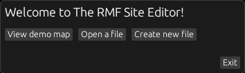

## Step 2: create the site

1. Click **Create new file**.
2. In the save dialog, go to this repository's `maps/my_site/` and type the
   name
   **`my_site`**, without any extension. Then click **Save**.
   - The site's name is the file name minus its last extension. If you type
     `my_site.site.json`, the site is called `my_site.site`, and every
     generated file is named after that. The name can't be changed in the
     editor afterwards.
3. You get an empty level **L1**. Press **F2** (mouse over the canvas) for
   the top-down view.
4. In the right panel, close **Scenarios** and **Tasks** (click their
   headings). This keeps **Inspect** on screen.

## Step 3: add the floorplan and give it a scale

1. Click the 🖼️ **Drawing** tool. Leave **Source** on **Local** and
   **Relative** ticked, click **Browse**, and pick `my_site.png`. The box
   shows just `my_site.png`: the path is relative to the site file.
2. Click **Add Drawing**.

   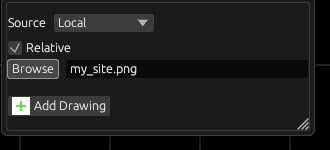

3. Select the drawing: open **Layers**, and under **Drawings** click the
   first (select) icon on the drawing's row. Then close **Layers** again,
   so the drawing's fields in **Inspect** come into view. Set:
   - **Name**: `my_site`
   - **Pixels per meter**: `50`
   - **x**: `-1`, **y**: `13`. This is where the image's **top-left corner**
     goes, in metres.

   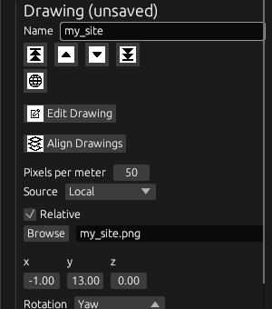

4. Press **Esc** over the canvas to deselect, then **File > Save**.

Zoom and pan until the whole room is in view. The red line is the x axis and
the blue line the y axis. The room's bottom-left corner sits where they cross.

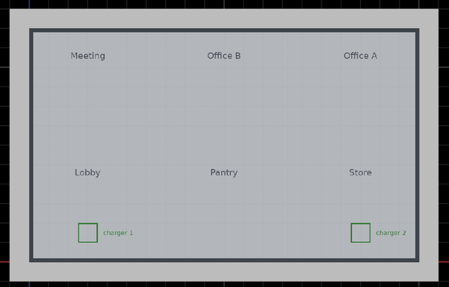

**For your own floorplan:** pixels per metre = (length of something in
pixels) ÷ (its real length in metres). Measure a long wall in an image editor.
Then choose x, y so the top-left corner of the image lands where you want it.
Alternatively, the inspector's **Edit Drawing** mode has a 📏 **Measurement**
tool. Draw a line along a known distance, enter that distance, return to the
site editor, and click **Align Drawings**.

## Step 4: floor and walls

The floor is what the robots drive on in Gazebo. Walls are optional, but they
make the simulation look like the building.

**Draw the floor first.** In 0.0.3 the Floor tool can't *start* on a point
that already exists: the status bar shows
`The state is missing from the workflow buffer` and the tool stops. Drawing
the floor before the walls avoids this, and the walls can then reuse the
floor's corners.

**Floor:**

1. Click the ✏ **Floor** tool.
2. Click the four room corners in turn: bottom-left, bottom-right,
   top-right, top-left.
3. Click the first corner again to close the floor, then press **Esc**
   twice.

The floor is drawn over the floorplan and dims it. The labels stay
readable. To see them better, open **Layers** and lower the **Floors ›
Global** value (the floor's opacity in the editor) to e.g. `0.2`.

**Walls:**

1. Click the ■ **Wall** tool.
2. Click the same four corners, then the bottom-left one again. Hover until
   a corner point highlights before clicking, so the wall reuses the
   floor's corner.
3. Press **Esc** twice.

**Make the corners exact:** click a wall. The inspector lists its **start**
and **end** points with **x** and **y** fields. Type the exact values,
(0, 0), (20, 0), (20, 12) and (0, 12), selecting another wall for the
corners the first one doesn't have. The floor shares the corners, so it
follows.

**File > Save.**

## Step 5: create the navigation graph

A navigation graph is the set of lanes one fleet may use. Its name becomes the
nav-graph file name (`tinyRobot` → `tinyRobot.nav.yaml`), so name it after
your fleet.

1. Find the **Navigation** section in the right panel, below **Models**.
2. It has a **View** / **Remove** switch, then an **Add** row: the **Add**
   button, a colour swatch and a name box that already contains the text
   `<Unnamed>`. Click into that name box, delete `<Unnamed>`, and type
   **`tinyRobot`**.
3. Click **Add** once. Every click adds another graph, even with the same
   name.
4. A row for the new graph appears below the Add row: a tick box (show or
   hide the graph's lanes), the graph's ID (`*` until you save), its colour,
   and its name. Check that the name reads exactly `tinyRobot`. If it shows
   something like `<Unnamed>tinyRobot`, click into the row's name box,
   clear it, type `tinyRobot`, and press Enter.
5. If you added more than one graph, click **Remove**, then the 🗑 icon on
   the extra row. The section switches back to **View** after each removal.

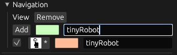

The name box next to **Add** keeps what you typed. That's normal; only the
rows below it are graphs.

## Step 6: draw the lanes

Lanes go two ways by default, and they belong to all graphs, so with a single
graph there's nothing else to set.

1. Click the ↔ **Lane** tool. Using the labels on the floorplan, click:
   - **Lobby → Pantry → Store → Office A → Office B → Meeting → Lobby**,
     then press **Esc** once to end the chain (you stay in the tool).
   - **Pantry → Office B**, then **Esc** once.
   - **Lobby → charger 1**, then **Esc** once.
   - **Store → charger 2**, then **Esc** twice to leave the tool.
   Each place's point is a little below its label (see the table in
   [The plan](#the-plan)). It needn't be exact: step 7 sets exact
   positions.
2. When you start a chain on a point that already exists (such as Pantry),
   hover until it highlights, then click. The new lane then shares that point.
3. **File > Save.**

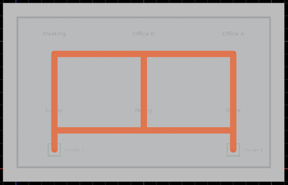

## Step 7: name the waypoints

A lane point becomes a named waypoint once it has a **location** on it.

1. Click the 📌 **Location** tool, click each of the 8 lane points (they snap
   onto the points), then press **Esc**.
2. For each point, set its name and exact position:
   - Click the point. The inspector shows the point (**Anchor**), with a
     **Dependencies** list. Under **Location**, click the button (e.g.
     `#35`) to open the location.
   - In the location's inspector, set **Name** (delete the `<Unnamed>` text
     first), and type the exact **x** and **y** from the table in
     [The plan](#the-plan).

   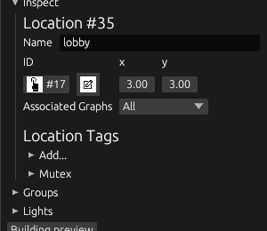

3. **Chargers:** for `tinyRobot1_charger`, and again for
   `tinyRobot2_charger`, open **Location Tags › Add...** and add three tags.
   The menu moves on to the next unused tag after each **Confirm**:
   - **Confirm** with **Charger** selected.
   - **Confirm** with **Parking Spot**.
   - Pick **Holding Point** in the menu, then **Confirm**.

   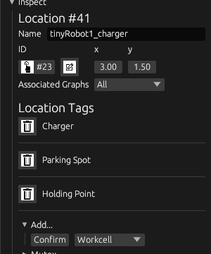

4. **File > Save.**

A location placed off a lane is silently left out of the nav graph. Every
waypoint must sit on a lane point.

## Step 8: add the robots

This step has three parts: add the TinyRobot model, mark it as a robot, and
place two copies.

**8a. Add the model and place the first robot:**

1. Click the 🔩 **Model** tool. Under **New Model Description**, set:
   - **Name**: `TinyRobot` (replace the `<Unnamed Description>` text)
   - **Source**: **Search**, then type `Open-RMF/TinyRobot` in the box below
     it.
2. Click **Add Description**. The editor downloads the model and lets you
   place one copy: click on **charger 1**.

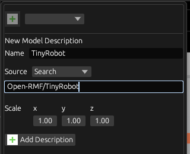

**8b. Mark it as a robot. This is essential.** Without it, the robot is
exported as a static object, RMF never sees it, and it never moves.

1. Select the robot. The easiest way is the **Models** panel: expand
   **TinyRobot** and click the select icon on the robot's row. Its
   properties appear in the **Inspect** panel.
2. In **Inspect**, under **Description Properties of [TinyRobot]**, expand
   **Configure Properties** and click **Robot** so that it is highlighted.

   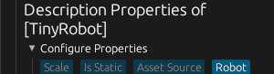

3. Scroll down (mouse wheel over the panel) to **Robot Properties** and tick
   all four. Each one opens its settings when ticked:
   - **Mobility**: **Mobility Kind** = **Differential Drive**, and tick
     **Bidirectional** (tinyRobot can reverse).
   - **Collision**: **Collision Kind** = **Circle Collision**,
     **Collision Radius** = `0.3`.
   - **Power Source**: **Power Source Kind** = **Battery**. The defaults
     (12 V, 24 Ahr, 5 A) match tinyRobot.
   - **Power Dissipation**: tick both **Ambient System** and
     **Mechanical System**. The defaults match tinyRobot.

   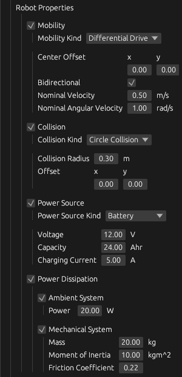

These properties belong to the TinyRobot *description*, so every TinyRobot
you place gets them.

**8c. Name and place the robots:**

1. With the robot still selected, scroll back up and set in **Inspect**:
   - **Name**: `tinyRobot1` (replace `TinyRobot_0`)
   - **x** `3`, **y** `1.5`
   - **Rotation**: change **Quaternion** to **Yaw**, and make the robot
     face up the lane (90°). The button next to the number shows the unit,
     and clicking it switches between `rad` and `deg`. Switch it to `deg`
     and enter `90` (or enter `1.5708` in `rad`).

   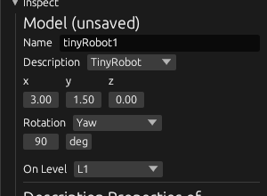

2. Second robot:
   1. Click the 🔩 **Model** tool, choose **TinyRobot** in the menu at the top
      of the tool window, click the green **+** next to it, then click once
      on **charger 2** and press **Esc**.
   2. In the **Models** section, expand **TinyRobot**. Check that there are
      **exactly two** rows, `tinyRobot1` and one `TinyRobot_0`. Placing can
      drop extra copies, possibly far outside the room. Delete any extra
      `TinyRobot_0` with its 🗑 icon.
   3. Select the remaining `TinyRobot_0` with its select icon and set
      **Name** `tinyRobot2`, **x** `17`, **y** `1.5`, **Rotation** Yaw 90°
      (as above). Setting x and y moves it onto charger 2, wherever it
      landed. It already has the robot properties.
3. **File > Save.**

The robot names matter: the fleet config in step 10 refers to them.

## Step 9: what you have now

`maps/my_site/` contains `my_site.site.json` and `my_site.png`. You don't need
to export anything from the editor. The package build in the next step
generates the Gazebo world and the nav graph from the `.site.json`.

To look at the generated files anyway, use **File > Export Sdf** and **File >
Export Nav Graphs**. Or, without the GUI:

```bash
docker run --rm -v ./maps/my_site:/w -w /w --entrypoint bash quay.io/nexsoss/open-rmf:lyrical_sim-site \
  -c 'mkdir -p out/nav_graphs && rmf_site_editor my_site.site.json --export-sdf out/ --export-nav out/nav_graphs/'
```

`out/my_site.world` should contain `<uri>model://TinyRobot</uri>` twice, with
a `slotcar` plugin. `out/nav_graphs/tinyRobot.nav.yaml` should list your 8
waypoint names.

## Step 10: make it a package and write the fleet config

From the repository root, copy the example package and rename everything to
`my_site`:

```bash
cd templates/site_sim
cp -r example_site my_site
cd my_site
mv maps/example_site maps/my_site
mv config/example_site config/my_site
mv launch/example_site.launch.xml launch/my_site.launch.xml
rm maps/my_site/example_site.*
grep -rl example_site . | xargs sed -i 's/example_site/my_site/g'
cp ../../../maps/my_site/my_site.site.json ../../../maps/my_site/my_site.png maps/my_site/
cd ../../..
```

The package now has:

```
my_site/
├── CMakeLists.txt                       # generates world + nav graphs at build time
├── package.xml
├── maps/my_site/my_site.site.json       # your site
├── maps/my_site/my_site.png             # its floorplan (shown in the dashboard)
├── config/my_site/tinyRobot_config.yaml # the fleet config
└── launch/my_site.launch.xml            # starts RMF, Gazebo and the fleet adapter
```

**The fleet config,** `config/my_site/tinyRobot_config.yaml`, describes the
fleet to RMF. The fields that must agree with your site:

```yaml
rmf_fleet:
  name: "tinyRobot"            # the fleet's name
  ...
  robots:                      # one entry per robot in the site
    tinyRobot1:                # = the robot's Name in the editor
      charger: "tinyRobot1_charger"   # = a location tagged Charger
    tinyRobot2:
      charger: "tinyRobot2_charger"
```

- A robot listed here but missing from the site never appears.
- A robot in the site but missing here is simulated but never given tasks.
- The other values (speed limits, footprint, battery) are the tinyRobot
  defaults. Keep `profile.footprint` in step with the robot's Collision
  Radius.

**The launch file,** `launch/my_site.launch.xml`, points the fleet adapter at
the nav graph by its file name, `nav_graphs/tinyRobot.nav.yaml`. If your graph
has a different name, change that path to match.

## Step 11: build and run

```bash
SITE_PACKAGE=my_site docker compose -f docker-compose.yaml \
    -f templates/site_sim/compose.override.yaml up -d --build
```

The build fails with `FATAL: empty world` if the world couldn't be generated
(see [Troubleshooting](#troubleshooting)). Once the containers are healthy:

- Open the dashboard at http://localhost:3000. You should see your
  floorplan with the two robots on their chargers.
- Send a patrol:

  ```bash
  docker exec -it rmf-sim bash -c 'source /home/ws_rmf/install/setup.bash && \
    ros2 run rmf_demos_tasks dispatch_patrol -p office_a meeting -n 1 --use_sim_time'
  ```

  One robot leaves its charger, drives to `office_a` and then `meeting`, and
  returns to charge. You can also create tasks from **NEW TASK** in the
  dashboard.

To watch the robots in Gazebo and RViz, run the simulation from a distrobox
made from your image instead of the compose `rmf-sim` service. See
[RMF, Gazebo and RViz, one terminal each](../../README.md#rmf-gazebo-and-rviz-one-terminal-each);
use `localhost/open-rmf:lyrical_my_site` as the image and launch
`my_site my_site.launch.xml`.

## Adding another robot

1. In the editor, add a lane from a free point to a new charger point, put a
   location on it named e.g. `tinyRobot3_charger`, and tag it **Charger**,
   **Parking Spot** and **Holding Point** (step 7).
2. Place a third TinyRobot on it and name it `tinyRobot3` (step 8c). It
   inherits the robot properties.
3. Add it to the fleet config:

   ```yaml
       tinyRobot3:
         charger: "tinyRobot3_charger"
   ```

4. Rebuild with the command in step 11.

## Troubleshooting

| What you see | Why | Fix |
|---|---|---|
| Build fails with `FATAL: empty world` | The editor could not export the world (for example, a model whose mesh couldn't be loaded) | Run the step 9 export command and read its output |
| Robots don't appear in the dashboard; `/fleet_states` has no robots | The TinyRobot description was not marked **Robot** (step 8b), so the export made it a static object | Do step 8b, save, rebuild. Check with step 9: `model://TinyRobot` must be in the world |
| A robot is in Gazebo but never gets tasks | Its name differs between the site and the fleet config | Make the names identical |
| `tinyRobot.nav.yaml` is missing, or called `<Unnamed>.nav.yaml` | The graph's name box still had `<Unnamed>` in it | Rename the graph (step 5) |
| A waypoint is missing from tasks or the nav graph | Its location is not on a lane point | Move it onto a lane point |
| Generated files are called `my_site.site.world` | The site was created with `.site.json` typed in the name | Edit `"name"` under `"properties"` at the top of the `.site.json` |
| Blank map in the dashboard | No drawing, or its image is not next to the `.site.json` | Check the drawing's path in **Inspect** (Browse again if needed) |
| The drawing path looks like `../other/../my_site/my_site.png` | **Save As** to another folder rewrote the relative path | Select the drawing, **Browse** to the image again, save |
| Something disappeared | Delete/Backspace with it selected; there is no undo | Close the editor without saving, start it again and use **Open a file** |
| The status bar shows `The state is missing from the workflow buffer` and the Floor tool stops | The floor's first click was on an existing point (a 0.0.3 bug) | Start the floor on an empty spot, or draw the floor before the walls (step 4) |
| Gazebo exits on start with `ODE INTERNAL ERROR … assertion "vertices" failed` | A non-static model whose mesh the editor can't load was exported as an empty collision mesh | Make that model static, or remove it |

## Compare with the answer key

`example_site/maps/example_site/example_site.site.json` is this tutorial's
result. Your file will have different internal IDs, and corners you placed by
hand may differ by a few centimetres. The names, positions, tags and robot
properties should match.
